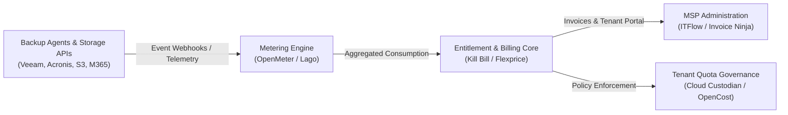

# Awesome Cloud Backup Account & License Management 🛡️☁️

  

  
  
  
  
  

> 🚀 **A curated directory of enterprise SaaS platforms and open-source GitHub projects for cloud backup account administration, multi-tenant license allocation, consumption metering, and automated MSP billing.**

📅 *Last updated: March 2026*

---

## 📑 Table of Contents

- [🔍 Overview](#-overview)
- [📈 Sector Overview & Market Dynamics](#-sector-overview--market-dynamics)
- [🏢 SaaS/Hosted Platforms](#-saashosted-platforms)
- [💻 Open-Source GitHub Projects](#-open-source-github-projects)
- [🏗️ Architecture & Integration Blueprint](#️-architecture--integration-blueprint)
- [🤝 How to Contribute](#-how-to-contribute)
- [💖 Support](#-support)
- [⭐ Star History](#-star-history)
- [⚖️ License & Disclaimer](#️-disclaimer)

---

## 🔍 Overview

Modern cloud backup and data protection ecosystems rely heavily on accurate tenant governance, entitlement management, and consumption-based billing. Managed Service Providers (MSPs), Cloud Solution Providers (CSPs), and enterprise IT departments require centralized consoles to:

- 🛡️ **Administer Tenants**: Enforce role-based access control (RBAC), multi-factor authentication (MFA), and tenant isolation.
- 📊 **Track License Consumption**: Meter protected workloads across virtual machines, physical servers, Microsoft 365 seats, and cloud object storage.
- 💳 **Automate Billing**: Reconcile usage against committed minimum quantities (CMQ), overages, and tiered partner discounts.

---

## 📈 Sector Overview & Market Dynamics

The global cloud backup and data recovery market is estimated at **$7.1B to $7.9B in 2026** (projected to reach over $25B by 2033 at a CAGR of ~18–20%). The sector exhibits **moderate fragmentation with aggressive consolidation**, transitioning from pure point backup tools toward consolidated cyber-resilience and security platforms where market leaders scale through multibillion-dollar mergers and acquisitions (e.g., Cohesity acquiring Veritas Data Protection, EQT acquiring Acronis, Kaseya acquiring Datto).

---

## 🏢 SaaS/Hosted Platforms

The table below catalogs enterprise cloud backup management, licensing, and partner platforms, sorted in descending order by company scale (market capitalization, recent private equity transaction valuation, or verified ARR).

| Product 📦 | Company Scale (Valuation / Revenue) 🌐 | Description 📝 | Pricing (Starting Tier) 💵 | Free Tier / Trial Limits 🎁 |
|---|---|---|---|---|
| **[Rubrik Security Cloud](https://www.rubrik.com/)** | **~$24B Market Cap** ($1.32B Revenue) | Enterprise data resilience platform delivering unified SaaS license governance, zero-trust data security, and transferable universal licenses across hybrid workloads and cloud apps. | $3.80/user/month (Foundation Edition SaaS for Microsoft 365, 100 GB cap) | 30-day enterprise trial / POC (limited to 500 users and 10 TB capacity) |
| **[Veeam Service Provider Console](https://helpcenter.veeam.com/docs/vac/provider_admin/about.html)** | **$15B Valuation** (~$2B ARR) | Multi-tenant cloud management console purpose-built for VCSP partners to centrally administer BaaS/DRaaS, provision Pulse license keys, and automate monthly usage reporting. | Free console; managed workload rental rates start at ~$1.20/month per M365 user and ~$6.50/month per VM | Free console download for VCSP partners; 30-day evaluation licenses available per workload |
| **[Cohesity Helios](https://www.cohesity.com/)** | **~$8B Valuation** ($1.7B Combined Revenue) | Unified data management SaaS offering a single control plane across enterprise backup, threat defense, and secondary storage, expanded by the Veritas enterprise backup integration. | $5.00/user/month (SaaS M365 protection) or ~$90/TB/year for capacity subscriptions | 30-day free trial / guided proof-of-concept (POC) via sales engineering |
| **[Commvault Command Center](https://documentation.commvault.com/)** | **~$6.8B Market Cap** ($1.18B Revenue) | Web-based multi-tenant administration interface with dedicated license recalculation, RBAC roles (Tenant Admin, MSP Subscription), and compliance tracking. | $1.70/user/month (Commvault Cloud Standard for M365, 5 GB storage) or $102.49/month per 10-VM pack | 30-day free trial across Commvault Cloud workloads (no credit card required) |
| **[Datto Partner Portal](https://saasprotection.datto.com/)** | **$6.2B Acquisition** (by Kaseya) | Dedicated MSP management platform providing license provisioning, committed minimum quantity (CMQ) management, and consolidated billing for Datto SaaS Protection. | $1.50/user/month (M365/Google Workspace protection in 500+ seat tier) | 14-day free trial (up to 500 endpoints for partner evaluation) |
| **[Acronis Cyber Cloud](https://www.acronis.com/)** | **~$4B Valuation** (~$420M Revenue) | Cloud platform for service providers combining cyber protection, backup license provisioning, tenant quota enforcement, and per-workload or per-gigabyte billing models. | €2.60/seat/month for M365, €4.42/month per workstation, and €31.20/month per server | Free onboarding model with restricted quota; 30-day full-feature trial for new service providers |
| **[Barracuda Cloud Control](https://www.barracuda.com/)** | **$4B Acquisition** (by KKR) | Centralized cloud management portal providing single sign-on (SSO), administrative control, and license allocation across Barracuda cloud-to-cloud backup and security solutions. | $2.80/user/month (Barracuda Cloud-to-Cloud Backup for Microsoft 365) | 60-day free trial on selected cloud services (14–30 days for appliance backup solutions) |
| **[Druva Account Management](https://www.druva.com/)** | **$2B Valuation** ($200M+ ARR) | 100% SaaS data protection platform utilizing credit-based storage metering (1 credit = 1 TB compressed/deduplicated data/month), tenant provisioning, and Data Lock immutability. | $2.50/user/month (Druva inSync endpoint backup) or $4.00/user/month (M365 Business tier) | 30-day free trial (fully functional, self-service without credit card requirement) |
| **[Carbonite Partner Portal](https://www.carbonite.com/)** | **$1.42B Acquisition** (by OpenText) | Partner ecosystem portal with deal registration, RMM integration, and flexible usage-based billing tiers for MSPs and IT solution providers. | $5.00/month (Carbonite Safe Core entry tier) or $24.99/month for Server Backup (up to 100 GB) | 15-day free trial for desktop backup; 30-day free trial for small business server backup |
| **[Backblaze B2 Admin](https://www.backblaze.com/)** | **~$520M Market Cap** ($145.8M Revenue) | Multi-account management and S3-compatible cloud storage administration console featuring application keys, bucket policies, and usage-based billing. | $6.95/TB/month ($0.00695/GB) storage; free egress up to 3x monthly average data stored | 10 GB cloud storage free forever; free upload and download egress allowances |

---

## 💻 Open-Source GitHub Projects

For MSPs, DevOps teams, and platform engineers building vendor-neutral license management consoles or internal usage-based billing architectures, these open-source repositories provide foundational frameworks. Sorted by GitHub star count in descending order:

| Project 🛠️ | Star Badge ⭐ | Primary Focus 🎯 | Description 📖 |
|---|---|---|---|
| **[Infracost](https://github.com/infracost/infracost)** |  | Cloud Cost & Usage Estimation | Cloud cost estimation for Terraform and infrastructure code. Frequently integrated into cloud backup pipelines to predict and prevent storage license overages. |
| **[Lago](https://github.com/getlago/lago)** |  | Metering & Usage-Based Billing | Open-source usage metering and subscription billing engine. Provides real-time event aggregation, multi-tier pricing, prepaid credit wallets, and automated customer invoicing. |
| **[Invoice Ninja](https://github.com/invoiceninja/invoiceninja)** |  | Invoicing & Client Management | Self-hosted client management and recurring billing platform. Extensively used by independent MSPs to invoice clients for backup seat and storage consumption. |
| **[Crater](https://github.com/crater-invoice/crater)** |  | Invoicing & Payment Tracking | Modern open-source suite for tracking client estimates, invoices, and payment lifecycle with REST APIs and mobile apps for service management. |
| **[Flexprice](https://github.com/flexprice/flexprice)** |  | Usage Pricing & Entitlements | Developer-first billing and entitlement engine designed to meter API usage, manage software feature tiers, and govern tenant license quotas in real time. |
| **[OpenCost](https://github.com/opencost/opencost)** |  | Kubernetes & Storage Allocation | CNCF project for real-time Kubernetes cluster cost monitoring and cloud storage allocation tracking across multi-tenant container workloads. |
| **[Cloud Custodian](https://github.com/cloud-custodian/cloud-custodian)** |  | Cloud Governance & Compliance | Rules engine for cloud resource management, policy enforcement, lifecycle tracking, and automated tagging across multi-account AWS, Azure, and GCP backup storage. |
| **[Kill Bill](https://github.com/killbill/killbill)** |  | Subscription Billing & Entitlements | Enterprise-grade billing engine handling complex multi-tenant subscription catalogs, usage overage calculations, automated dunning, and payment gateway routing. |
| **[OpenMeter](https://github.com/openmeterio/openmeter)** |  | Real-Time Usage Metering | High-throughput consumption metering platform built on Apache Kafka and ClickHouse to ingest and aggregate millions of backup storage and workload events per second. |
| **[FOSSBilling](https://github.com/FOSSBilling/FOSSBilling)** |  | Client Billing & Hosting Admin | Lightweight open-source client management and recurring billing platform tailored for web hosts, IT providers, and cloud service resellers. |
| **[ITFlow](https://github.com/itflow-org/itflow)** |  | MSP Documentation & Billing | Dedicated open-source IT documentation, client ticketing, asset tracking, and recurring accounting suite designed exclusively for Managed Service Providers. |
| **[BillaBear](https://github.com/billabear/billabear)** |  | Subscription Management | Self-hosted subscription workflow management engine featuring automated tax handling, invoice lifecycle management, and Stripe integration. |

---

## 🏗️ Architecture & Integration Blueprint

To build a custom, vendor-neutral license management and metering stack without vendor lock-in:

1. 📥 **Ingestion & Metering**: Collect raw backup storage and protected node metrics via webhooks into **OpenMeter** or **Lago**.
2. 🔐 **Entitlement Governance**: Validate consumption against contracted customer quotas using **Flexprice** or **Kill Bill**.
3. 🧾 **Invoicing & Customer Portal**: Sync billing records to **Invoice Ninja** or **ITFlow** for transparent client reporting.

---

## 🤝 How to Contribute

Contributions are welcome from MSP engineers, cloud architects, and developers!

1. 🍴 Fork this repository.
2. 📝 Add your tool to either the [SaaS/Hosted Platforms](#-saashosted-platforms) or [Open-Source GitHub Projects](#-open-source-github-projects) section.
   - For SaaS tools: include company valuation/revenue, concise description, specific entry-level pricing, and exact free tier/trial terms.
   - For open-source tools: include the official GitHub star badge linking to `/stargazers`, focus area, and architectural summary.
3. 🚀 Submit a Pull Request with a clear description of the project.

---

## 💖 Support

Thank you for visiting and using this curated ecosystem guide! If you find this repository valuable:

- ⭐ **Star this repository** to help others discover it.
- 🍴 **Fork it** to contribute additions, corrections, and new platforms.
- 📢 **Share it** with your fellow MSP engineers, cloud architects, and DevOps peers.
- ☕ If this resource saved you hours of research and vendor evaluation, you can also support continuous maintenance by buying a coffee via the **[GitHub Sponsor Dashboard](https://github.com/sponsors/ishandutta2007)**!

---

## ⭐ Star History

---

## ⚖️ Disclaimer

- 📌 This list is community-curated for informational purposes and does not constitute an endorsement.
- 🏢 All product names, logos, and brands are property of their respective owners.
- 🔒 Cloud backup management consoles handle critical tenant metadata and billing records; ensure implementations strictly comply with data protection regulations (GDPR, HIPAA, SOC 2).
